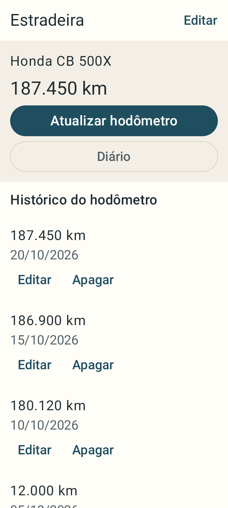
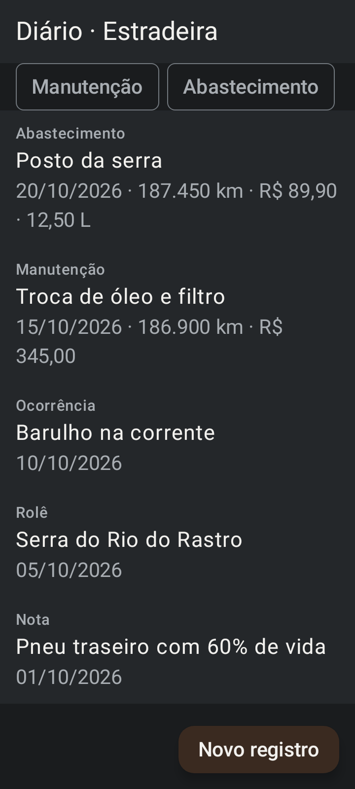
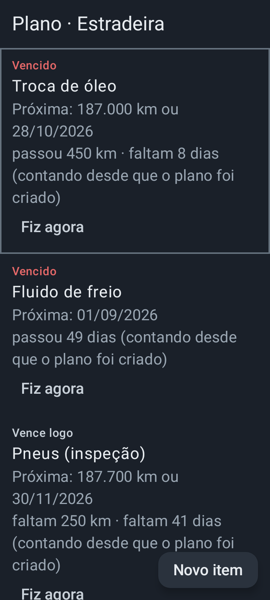
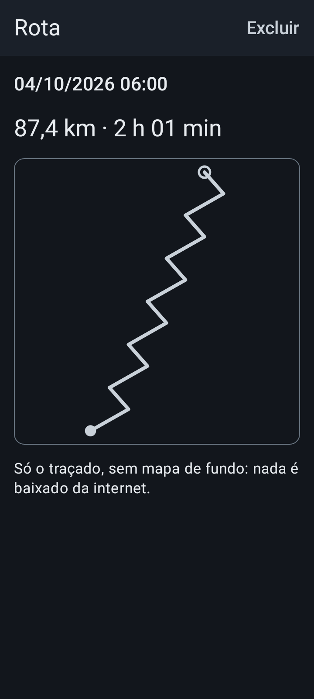

# Diário de Bordo — estudo de caso

> App Android de diário de bordo e manutenção para motociclistas: registra abastecimentos, manutenções e rolês, e avisa quando a próxima revisão vence, tudo no aparelho, sem internet. · Projeto de portfólio de Pedro Henrique Rodrigues Marques · novembro/2026
> Demonstração: VÍDEO_A_GRAVAR · Ao vivo: ainda não publicado na Play Store, veja o vídeo · Stack: Kotlin, Jetpack Compose + Material 3, Room, Hilt, WorkManager



Todas as telas e números deste documento usam dados de exemplo inventados (motos, valores e rotas fictícios). Nenhum dado real, de ninguém, aparece aqui.

## 1. O problema

Quem anda de moto costuma controlar abastecimento, troca de óleo e revisão em planilha, caderno ou de cabeça. Na estrada, com luva e sem sinal, nada disso se preenche, e a revisão passa do prazo sem ninguém ver. Falta um lugar único, que funcione sem internet e diga o que está vencido.

## 2. A solução

- **Garagem e hodômetro:** cadastro de motos e histórico de quilometragem. O km atual é a maior leitura, e o km nunca volta.
- **Diário:** abastecimento, manutenção, ocorrência, rolê e nota, com fotos e, só se a pessoa tocar em "usar local atual", o local do registro.
- **Plano de manutenção:** itens por km e/ou dias, com o estado "em dia", "vence logo" ou "vencido" e lembretes por notificação.
- **Rota do rolê:** gravação por GPS em serviço de primeiro plano e traçado salvo no aparelho, sem mapa de fundo (nada é baixado da internet).
- **Feito para a oficina e a estrada:** 3 temas (Oficina, Estrada, Cromo), modo oficina com letra e alvos maiores, backup em `.zip` pelo seletor do sistema.

| Diário (tema Oficina, fonte 140%) | Plano (tema Cromo, fonte 140%) | Rota (tema Cromo, fonte 140%) |
|---|---|---|
|  |  |  |

As capturas são as do Roborazzi, versionadas no repositório e conferidas pelo CI a cada PR, com dados de exemplo dos próprios testes.

## 3. Decisões que valem contar

| Decisão | Opções consideradas | Por que esta | Fonte |
|---|---|---|---|
| Offline-first: o Room é a fonte da verdade e nada no MVP depende de rede | Servidor e banco remoto desde o início | O app precisa funcionar na estrada, sem sinal; a nuvem só entra no premium e o MVP roda sem custo de servidor | [`docs/plano-de-produto.md`](docs/plano-de-produto.md), "Stack técnica"; [`docs/offline-first.md`](docs/offline-first.md) |
| Rota como traçado simples, sem mapa de fundo | Mapa de fundo | O mapa de fundo não funciona sem rede, a menos que a área já esteja em cache; mapas offline por região ficam para depois do MVP | [`docs/plano-de-produto.md`](docs/plano-de-produto.md), "Mapa sem internet" |
| Rota salva só com o traçado simplificado; os pontos brutos do GPS são apagados ao encerrar | Guardar todos os pontos | Menos dado de localização guardado no aparelho e no arquivo exportado | Decisão #17; [`RotaRepositorio.finalizar`](app/src/main/java/com/pedrohrsm/diariodebordo/rota/data/RotaRepositorio.kt) |
| Banco na versão 1 até a primeira publicação; só o build de debug recria o banco se faltar migração, e o release nunca apaga o diário | Migração a cada mudança desde o início | Evita um histórico de migrações antes de existir um usuário; o diário real nunca é apagado | Decisão #12; [`DatabaseModule`](app/src/main/java/com/pedrohrsm/diariodebordo/core/di/DatabaseModule.kt) |
| Backup em `.zip` pelo seletor do sistema, com aviso de dado pessoal e opção de sair sem rotas e sem locais | Backup em nuvem | Sem servidor e sem permissão de armazenamento; a pessoa escolhe o que sai do aparelho | [`docs/plano-de-acao.md`](docs/plano-de-acao.md), item 1.9; PRs #45 e #74 |
| O AAB de release tem um teto de tamanho no CI; passar de 50 KB num PR é decisão do dono | Sem limite de tamanho | O tamanho cresce em silêncio com cada dependência; cada subida do teto fica registrada com o motivo | [`ferramentas/teto-aab.txt`](ferramentas/teto-aab.txt); decisões #53, #59, #71 e #75 |
| Dados de exemplo só no build de debug (source set `debug`), instalável ao lado do app real | Flag de build no release | O release nem compila o código de exemplo, e o debug usa outro `applicationId` e outro banco | Frente #77; [`app/src/debug`](app/src/debug/java/com/pedrohrsm/diariodebordo/exemplo) |

## 4. Como foi construído

**Arquitetura.** Um módulo `:app`, pacotes por funcionalidade (`garagem`, `diario`, `plano`, `numeros`, `localizacao`, `rota`, `backup`) e `core` para o que é compartilhado. MVVM com Hilt, Coroutines e Flow; Room como fonte da verdade; WorkManager para os lembretes. Regra de negócio em funções de domínio puras, testadas na JVM. Toda tela usa o mesmo esqueleto (`TelaDiario`, edge-to-edge) e toda cor vem do `ColorScheme`, com par nos 3 temas.

**Método.** Desenvolvido com o Framework Aprendido: um PM de projeto coordenando agentes de IA por frentes, com revisão antes de cada merge, CI e testes.

**Qualidade (só o que foi medido, ver "Fontes dos números").** Cada PR passa pelos mesmos portões do CI: guardas de idioma, cor e texto fixo; ktlint; testes dos scripts de ferramentas; provas negativas (todo teste novo aparece no PR com o bug que o fez falhar); lint; build; testes unitários; capturas do Roborazzi comparadas com as commitadas; verificação do manifesto do release; AAB dentro do teto de tamanho.

## 5. Resultados em números

| Indicador | Valor | Fonte |
|---|---|---|
| Tempo do primeiro commit ao último da `main` | 10 dias de calendário (26-Out a 5-Nov-2026) | F1 |
| PRs integrados na `main` | 17 PRs (26 commits; o PR #27 entrou com 7 commits, sem squash) | F2 |
| Testes unitários automatizados | 757, nenhum falhando nem ignorado | F3 |
| Capturas de tela versionadas (Roborazzi) | 372 imagens | F4 |
| Destinos de navegação do app | 14 | F5 |
| Tamanho do AAB de release | 5.210.312 B (cerca de 5,0 MiB), com teto de 5.210.245 B + tolerância de 2.048 B | F6 |

## 6. O que aprendi

- **Escrever código deixou de ser o gargalo.** As frentes de IA escreveram as Fases 0 e 1 em 3 dias de calendário, e nada disso tinha passado por um CI (13 execuções, 0 verdes). O trabalho de verdade foi fazer o CI funcionar e revisar em fatias pequenas ([`docs/CRONOGRAMA.md`](docs/CRONOGRAMA.md), seção 0).
- **Cada dependência pesa, e o teto do AAB mostra isso.** O serviço de localização do Google somou cerca de 331 KB e a biblioteca de serialização do backup, cerca de 260 KB ao teto do AAB; as duas subidas viraram decisão registrada ([`ferramentas/teto-aab.txt`](ferramentas/teto-aab.txt)).
- **Contraste não se confere a olho.** Duas correções de tema (#47 e #55) vieram de contraste abaixo do mínimo nas cores do Figma e em componentes; hoje um teste confere cada par de cores nos 3 temas.
- **Sem dado de exemplo, não há vitrine.** Capturas e vídeo precisavam de dados que não fossem os de uso real; por isso o build de debug ganhou a ação "Carregar dados de exemplo", que o release não contém.

## 7. Como rodar

Pré-requisitos: JDK 21 e Android SDK com a plataforma 37 (`platforms;android-37.0`) e as ferramentas de build.

```bash
git clone https://github.com/pedrohrsm-crypto/Mobile-App-Moto.git
cd mobile-app-moto
# Aponte o SDK, se o ANDROID_HOME não estiver definido (o arquivo fica fora do git):
echo "sdk.dir=/caminho/do/Android/Sdk" > local.properties
./gradlew assembleDebug
```

O APK sai em `app/build/outputs/apk/debug/app-debug.apk`. Para instalar num aparelho ou emulador com Android 8 ou mais novo: `adb install -r app/build/outputs/apk/debug/app-debug.apk`.

- **Dados de exemplo (só no build de debug):** abra **Ajustes** e toque em **Carregar dados de exemplo**. Entram 2 motos fictícias, 6 meses de diário, leituras do hodômetro, itens do plano em estados variados e 2 rotas desenhadas por fórmula numa estrada pública (nenhuma é gravação de GPS de alguém).
- **Ao lado do app real:** o build de debug usa o `applicationId` `com.pedrohrsm.diariodebordo.debug` e o nome "Diário (exemplo)", então instala junto com o app de verdade, com banco e arquivos próprios.
- **Testes:** `./gradlew testDebugUnitTest`; capturas: `./gradlew verifyRoborazziDebug`.
- **APK de release assinado:** o CI gera um por push na `main`. No GitHub, abra **Actions** → **CI**, escolha o run verde e baixe o `diario-de-bordo-release-<sha7>` em **Artifacts**. Para atualizar, instale o de um run mais novo por cima: os dados ficam.

**Aviso:** a versão da Play Store vai ser assinada por outra chave (Play App Signing) e não instala por cima do APK do CI; vai pedir para desinstalar, o que apaga os dados do aparelho. Antes de trocar, use **Exportar backup** nos ajustes, guarde o `.zip` fora do aparelho e, depois de instalar a versão da Play, use **Importar backup**.

## 8. Próximos passos

O que ficou fora do MVP:

- Ocultar o início e o fim das rotas (privacidade do ponto de partida).
- Ligar o diário ao plano de manutenção.
- Paradas do passeio.
- Limpeza de fotos órfãs.
- Mapa topográfico.
- Fases seguintes do [plano de produto](docs/plano-de-produto.md): teste fechado e lançamento na Play Store, backup em nuvem e relatório em PDF (premium).

## Fontes dos números

Todos os comandos foram rodados em 5-Nov-2026 na base `f015fd9` (`main`); o item F3 inclui também os 8 testes novos desta frente (#77).

| Número no texto | Fonte (comando) | Data |
|---|---|---|
| F1: 10 dias, 26-Out a 5-Nov-2026 | `git log origin/main --reverse --format='%h %ad' --date=short` (primeiro commit `3031086`, 26-Out-2026; último `f015fd9`, 5-Nov-2026) | 5-Nov-2026 |
| F2: 17 PRs, 26 commits | `git log origin/main --format=%s \| grep -E '\(#[0-9]+\)$' \| sed -E 's/.*\(#([0-9]+)\)$/\1/' \| sort -u \| wc -l` (17) e `git log origin/main --oneline \| wc -l` (26) | 5-Nov-2026 |
| F3: 757 testes | `./gradlew testDebugUnitTest`, soma dos atributos `tests` dos XML em `app/build/test-results/testDebugUnitTest` (78 classes, 0 falhas, 0 ignorados); 749 na `main` `f015fd9` sem esta frente | 5-Nov-2026 |
| F4: 372 capturas | `find app/src/test/snapshots -name '*.png' \| wc -l` | 5-Nov-2026 |
| F5: 14 destinos | `grep -c "composable(" app/src/main/java/com/pedrohrsm/diariodebordo/navegacao/DiarioNavHost.kt` | 5-Nov-2026 |
| F6: AAB de 5.210.312 B | `./gradlew bundleRelease` seguido de `bash ferramentas/teto-aab.sh`; o teto de 5.210.245 B vem de [`ferramentas/teto-aab.txt`](ferramentas/teto-aab.txt) (CI do PR #76, run 41877452812) | 5-Nov-2026 |
| 3 dias, 13 execuções, 0 verdes (seção 6) | [`docs/CRONOGRAMA.md`](docs/CRONOGRAMA.md), seção 0, medidos no repositório anterior | 28-Set-2026 |
| ~331 KB e ~260 KB (seção 6) | [`ferramentas/teto-aab.txt`](ferramentas/teto-aab.txt), comentário do teto (+259.684 B e +331 KB) | 5-Nov-2026 |

## Documentos

- [Plano de produto](docs/plano-de-produto.md): escopo, stack, roadmap, publicação na Play Store, monetização, custos, métricas e riscos
- [Offline-first](docs/offline-first.md): dados, GPS sem rede, lembretes, backup e sincronização
- [Planejamento com as áreas](docs/PLANEJAMENTO.md), [plano de ação](docs/plano-de-acao.md) e [cronograma](docs/CRONOGRAMA.md)
- [Design no Figma](https://www.figma.com/design/XLfpBLh0ndZhvYecq2uYbz): wireframe do fluxo e telas em alta fidelidade nos temas Oficina, Estrada e Cromo
- Construído por frentes de IA (Claude Code) sob o [Framework Aprendido](https://github.com/pedrohrsm-crypto/framework-aprendido) v2.0.
